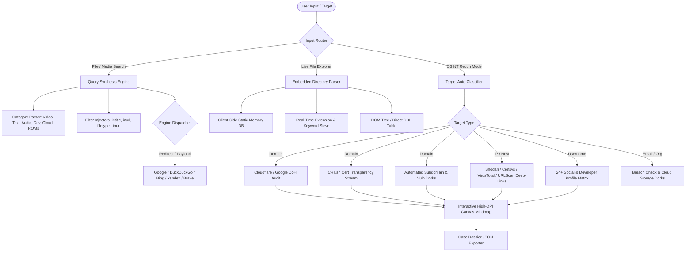

# SearchPro — Advanced Client-Side File Search & OSINT Reconnaissance Engine


<div align="center">

[](LICENSE)
[](#architecture)
[](#zero-cost-philosophy)
[](#privacy--compliance)
[](#creator--maintainer)
[](#analytics--telemetry)

<p align="center">
  <strong>An ultra-fast, zero-cost, privacy-first search query synthesizer, live open directory explorer, and passive OSINT reconnaissance framework engineered entirely on modern vanilla web standards.</strong>
</p>

[Live Application](https://search.sturio.io/) • [PSEO Guides Hub](https://search.sturio.io/pages/) • [HTML Sitemap](https://search.sturio.io/sitemap.html) • [Documentation](#table-of-contents)

</div>

---

## Table of Contents

- [Overview](#overview)
- [Core Engineering Pillars](#core-engineering-pillars)
- [System Architecture](#system-architecture)
- [Functional Capabilities](#functional-capabilities)
  - [1. Real-Time Dork Synthesis Engine](#1-real-time-dork-synthesis-engine)
  - [2. Embedded Live File Explorer](#2-embedded-live-file-explorer)
  - [3. Professional OSINT Reconnaissance Suite](#3-professional-osint-reconnaissance-suite)
  - [4. Multi-Search-Engine Dispatcher](#4-multi-search-engine-dispatcher)
  - [5. Programmatic SEO (PSEO) Pipeline](#5-programmatic-seo-pseo-pipeline)
- [Repository Structure](#repository-structure)
- [Query Operators & Syntax Reference](#query-operators--syntax-reference)
- [Passive OSINT Workflow & Protocol](#passive-osint-workflow--protocol)
- [Installation & Local Execution](#installation--local-execution)
- [Brand Identity & Indexing Assets](#brand-identity--indexing-assets)
- [Zero-Cost Philosophy](#zero-cost-philosophy)
- [Privacy, Safety & Ethical Guidelines](#privacy-safety--ethical-guidelines)
- [Creator & Maintainer](#creator--maintainer)
- [License](#license)

---

## Overview

**SearchPro** is an open-source, client-side cyber intelligence tool and open-directory locator created by **Rakib Ahmed**. It eliminates the latency, paywalls, and telemetry inherent in legacy file search indexers by running 100% in the user's browser runtime.

SearchPro constructs mathematically precise boolean search filters (Google Dorks) to isolate raw web server folder indexes (Apache, Nginx, Caddy, Lighttpd, IIS) and publicly accessible cloud storage nodes (Google Drive, Mega.nz, OneDrive, Dropbox, Mediafire, Archive.org, anonymous FTP). In addition, SearchPro incorporates a passive Open-Source Intelligence (OSINT) suite that performs real-time target auto-classification, high-DPI canvas interactive network topology mapping, asynchronous DoH email spoofing audits, and TLS certificate transparency log extraction with **zero server costs and zero third-party API keys**.

---

## Core Engineering Pillars

```
+-----------------------------------------------------------------------------------+
|                               SEARCHPRO CORE PILLARS                              |
+--------------------------+------------------------------+-------------------------+
|     100% Client-Side     |     Zero Server / API Cost   |     Strict Zero-Logs    |
|  No Node/Python backend  |   No paid APIs, subscriptions|   No database, no search|
|  required to query; runs |   or middleware; relies on   |   history sent to server|
|  in any modern browser.  |   public DoH and CT logs.    |   queries stay in RAM.  |
+--------------------------+------------------------------+-------------------------+
|    Dynamic UI Engine     |    Programmatic SEO Hub      |   Production Hardened   |
|  Tailwind-driven styles, |   50 pre-built static guides |   Full Schema.org JSON, |
|  clean minimal layouts,  |   covering movies, text, dev |   PWA manifest, GA4 and |
|  zero emojis, pure icons.|   tools, games, and clouds.  |   transparent SVG icons.|
+--------------------------+------------------------------+-------------------------+
```

- **True Client-Side Execution**: All query generation, target parsing, DNS record inspection, and mindmap graph layouts happen in JavaScript on the client device.
- **Zero Operating Expense ($0/mo)**: Designed from the ground up to operate with zero infrastructure bills. Can be served via GitHub Pages, Cloudflare Pages, Vercel, Netlify, or raw static hosting.
- **Privacy & Anonymity**: Search queries, targets, and parameters are never transmitted to any application backend. State is stored solely in browser `localStorage`.
- **Minimal, Professional Aesthetics**: Built with single-word button labels, responsive Tailwind utility architecture, curated amber/yellow brand palettes, and zero distracting graphical clutter.

---

## System Architecture

The following diagram illustrates how incoming user interactions flow through client-side query generation, live directory simulation, DoH security analysis, and external engine execution:



---

## Functional Capabilities

### 1. Real-Time Dork Synthesis Engine

SearchPro translates human-readable intents into complex search expressions that bypass landing pages, spam aggregators, and paywalls.

- **Automated Anti-Spam Exclusions**: Injects negative keywords (`-inurl:(html|php|asp|jsp) -intext:fake`) to eliminate spam portals and password-locked bait files.
- **Intelligent Extension Grouping**: Dynamically structures filetype operators based on selected formats (e.g., `(mkv|mp4|avi|mov)` for video, `(flac|wav|alac)` for uncompressed audio, `(iso|bin|chd|vpk)` for retro disc images).
- **Date-Range Filtering**: Supports recent file scoping (past 24 hours, week, month, or custom timeline) via native search engine query parameters.
- **Custom Site Target Scoping**: Directs focus into specific cloud providers (`drive.google.com`, `mega.nz`, `dropbox.com`, `mediafire.com`, `archive.org`).

### 2. Embedded Live File Explorer

A native, in-browser directory browser designed to simulate an open directory interface directly inside SearchPro:
- Fast in-memory search across thousands of index entries.
- Category filters (Video, Audio, Books, Documents, Software, Archives).
- Instant direct download link extraction without page reloads.
- Minimalist table UI featuring file name, size metadata, parent directory links, and instant copy buttons.

### 3. Professional OSINT Reconnaissance Suite

A passive, client-side intelligence dashboard for security researchers, penetration testers, and investigators:
- **Autonomous Target Classification**: Automatically detects whether an input is a **Domain**, **IPv4 Address**, **Email Address**, **Handle/Username**, or **Organization**, adapting the entire interface instantaneously.
- **Client-Side DNS-over-HTTPS (DoH) Audit**: Queries Cloudflare (`cloudflare-dns.com/dns-query`) and Google DoH APIs asynchronously to analyze `TXT`, `MX`, and `A` records. Automatically parses and evaluates SPF (`v=spf1`) and DMARC (`v=DMARC1`) policies to flag email spoofing and domain takeover vulnerabilities.
- **Live Certificate Transparency Sieve**: Connects directly to `crt.sh` JSON endpoints via CORS-friendly streams to discover wildcards, staging subdomains, development environments, and hidden endpoints with real-time deduplication.
- **24-Node Username Profile Matrix**: One-click reconnaissance across GitHub, Twitter/X, Reddit, LinkedIn, Telegram, Steam, Keybase, DockerHub, and 16 other developer and gaming networks.
- **High-DPI Interactive Network Topology (Mindmap)**: Custom HTML5 Canvas rendering of the entire target profile, radiating nodes for DNS hosts, mail exchangers, security posture, and subdomains with mouse dragging, smooth velocity physics, and dynamic auto-centering.
- **Structured Case Dossier Export**: Formats all collected host records, certificates, DNS findings, and investigator notes into a structured JSON Case File with a single click.

### 4. Multi-Search-Engine Dispatcher

Seamless routing across global search backends without query loss:
- **Google Search** (Full dork syntax compatibility)
- **DuckDuckGo** (Privacy-respecting metadata search)
- **Bing** (Microsoft index and cache search)
- **Yandex** (Alternative international crawling index)
- **Brave Search** (Independent web index)
- **Startpage, Ecosia, Qwant, Baidu**

### 5. Programmatic SEO (PSEO) Pipeline

SearchPro features an automated build system ([`generate_pseo.js`](generate_pseo.js)) backed by a database of over 100 global keywords and 50 categorized topic clusters:
- Generates 50 standalone, statically optimized HTML landing pages inside [`pages/`](pages/).
- Full schema integration: `BreadcrumbList`, `HowTo`, `TechArticle`, and `FAQPage` JSON-LD on every page.
- Visual HTML sitemap ([`sitemap.html`](sitemap.html)) and XML search engine sitemap ([`sitemap.xml`](sitemap.xml)).
- Automated RSS Syndication feed ([`feed.xml`](feed.xml)) for rapid indexing.

---

## Repository Structure

```
.
├── index.html                     # Primary application: Dork Synthesizer, Live Explorer, OSINT Suite
├── omnisearch_pro_minimal.html     # Ultra-lightweight fallback version
├── sitemap.html                   # Visual HTML directory index for users & crawlers
├── sitemap.xml                    # Standard XML search engine sitemap (59 URLs)
├── feed.xml                       # Automated RSS 2.0 feed for PSEO updates
├── robots.txt                     # Crawler directives and sitemap declaration
├── manifest.json                  # PWA specification (standalone display, theme tokens)
├── generate_pseo.js               # Node.js programmatic static page generator
│
├── 404.html                       # Custom styled 404 error page with quick links
├── about.html                     # Architectural overview & capabilities disclosure
├── privacy.html                   # Client-side zero-logging privacy policy
├── terms.html                     # Legal disclaimer & ethical usage terms
│
├── favicon.svg                    # Scalable vector favicon (transparent background)
├── favicon.ico                    # Multi-size binary icon container (16x16, 32x32, 48x48)
├── favicon-48.png                 # Google Search official 48x48 favicon
├── apple-touch-icon.png           # iOS Safari high-res bookmark icon (180x180)
├── icon-192.png                   # Android PWA launcher icon (192x192)
├── icon-512.png                   # High-density PWA app icon (512x512)
├── logo.svg                       # Master vector brand logo (transparent)
├── logo.png                       # High-resolution Schema.org organization logo
├── og-image.png                   # 1200x630 Open Graph & Twitter Card social banner
│
├── data/
│   └── keywords_database.json     # 106 global keywords, 50 clusters, category taxonomy & dork syntax
│
└── pages/                         # 51 Programmatic SEO Landing Pages
    ├── index.html                 # PSEO Knowledge Base Hub with 6 categorical silos
    ├── 3d-models-stl-obj-open-directory.html
    ├── 4k-wallpapers-photos-open-directory.html
    ├── academic-research-paper-pdf-search.html
    ├── anime-mkv-open-directory-finder.html
    ├── apk-mod-open-directory-finder.html
    ├── archive-org-open-directory-dorks.html
    ├── audiobook-mp3-open-directory-finder.html
    ├── cheatsheets-dev-pdf-open-directory.html
    ├── comics-cbz-open-directory-finder.html
    ├── compressed-zip-rar-open-directory.html
    ├── datasets-csv-json-open-directory.html
    ├── discord-public-file-search-engine.html
    ├── dork-generator-tool.html
    ├── dorks-cheat-sheet.html
    ├── dropbox-public-directory-finder.html
    ├── file-chef-alternative-search-engine.html
    ├── find-specific-file-websites-software.html
    ├── fonts-ttf-otf-open-directory.html
    ├── free-stock-videos-4k-open-directory.html
    ├── gdrive-audio-music-shared-folders.html
    ├── github-open-directory-dorks.html
    ├── google-drive-movies-search-engine.html
    ├── google-drive-search-engine-alternatives.html
    ├── google-drive-search-engine-pdf.html
    ├── google-drive-textbooks-pdf-search.html
    ├── kali-linux-tools-iso-open-directory.html
    ├── linux-mac-file-search-dorks.html
    ├── lumpy-soft-open-directory-alternative.html
    ├── manga-cbz-epub-open-directory.html
    ├── mediafire-direct-download-links.html
    ├── mega-nz-cloud-search-engine.html
    ├── movie-subtitles-srt-open-directory.html
    ├── obsidian-notion-templates-pdf-dorks.html
    ├── onedrive-cloud-storage-search-engine.html
    ├── open-directories-list-audio.html
    ├── open-directory-finder-video.html
    ├── open-ftp-server-index-finder.html
    ├── osint-open-directory-search-tools-list.html
    ├── programming-ebooks-pdf-google-drive.html
    ├── public-google-drive-search-tool.html
    ├── roms-emulators-open-directory-finder.html
    ├── searchpro-open-directory-engine.html
    ├── sound-effects-sample-packs-open-directory.html
    ├── soundtracks-flac-mp3-open-directory.html
    ├── telegram-channel-file-search.html
    ├── torrent-alternative-direct-link-finder.html
    ├── torrent-magnet-to-direct-link.html
    ├── vst-plugins-audio-open-directory.html
    └── web-scraper-directory-indexer.html
```

---

## Query Operators & Syntax Reference

| Operator | Primary Function | Example Query Payload |
|---|---|---|
| `intitle:"index of"` | Discovers raw directory index tables | `intitle:"index of" "Blade Runner" (mkv\|mp4)` |
| `site:drive.google.com` | Restricts search to public Google Drive shares | `site:drive.google.com "Computer Science" filetype:pdf` |
| `site:mega.nz` | Locates public Mega cloud storage folder links | `site:mega.nz/folder/ "dataset"` |
| `filetype:[ext]` | Forces specific file format matches | `"deep learning" filetype:pdf` |
| `-inurl:(html\|php)` | Negates dynamic landing pages and ad farms | `intitle:"index.of" -inurl:(php\|html\|asp)` |
| `intext:"parent directory"` | Matches authentic web server navigation breadcrumbs | `intext:"parent directory" "DCIM" (jpg\|png)` |
| `"last modified" "size"` | Isolates auto-generated server indexing grids | `intitle:"index of" "last modified" "size" flac` |
| `site:1drv.ms` | Discovers shared Microsoft OneDrive links | `site:1drv.ms "archive" (zip\|rar)` |

---

## Passive OSINT Workflow & Protocol

SearchPro's OSINT module conducts all operations under a strictly passive reconnaissance methodology:

```
[TARGET INPUT]
      │
      ├──> Auto-Classifier (Regex & Pattern Recognition)
      │
      ├──> Passive Cloudflare/Google DoH Queries
      │       ├── TXT Records (SPF / DMARC Inspection)
      │       ├── MX Records (Mail Exchanger Mapping)
      │       └── A Records (IP Resolution)
      │
      ├──> Direct CRT.sh REST Query
      │       └── Parsing SSL/TLS Certificate Transparency logs for subdomains
      │
      ├──> Client-Side Graph Layout
      │       └── Real-time interactive physics rendering on HTML5 Canvas
      │
      └──> JSON Case Dossier Generation
```

1. **Target Ingestion**: User inputs a domain, IP address, email, or username.
2. **Deterministic Classification**: Input is sanitized, validated, and classified into one of 5 intelligence vectors without sending queries to an application server.
3. **Encrypted Passive Probing**:
   - Sends DNS queries over encrypted HTTPS channels (`application/dns-json`) to Cloudflare and Google.
   - Parses SPF configurations to check for vulnerable permissive mechanisms (`+all`, `?all`, missing records).
   - Verifies DMARC enforcement policies (`p=none`, `p=quarantine`, `p=reject`).
4. **Subdomain Enumeration**: Fetches public Certificate Transparency logs from `crt.sh`, isolates unique host names, and filters noise.
5. **Interactive Visualization**: Spawns node clusters on a high-DPI canvas where researchers can inspect dependencies, copy hostnames, and launch correlated queries.
6. **Case File Export**: Exports the complete findings into an audit-ready, timestamped JSON dossier.

---

## Installation & Local Execution

SearchPro has **zero build steps** and requires no local package managers for regular usage.

### Option 1: Direct File Launch
Simply clone the repository and open `index.html` directly in any web browser:

```bash
git clone https://github.com/RakibAhmed/searchpro.git
cd searchpro
# Open index.html in your default browser:
# Windows
start index.html
# macOS
open index.html
# Linux
xdg-open index.html
```

### Option 2: Local Static Server (Node.js)
```bash
npx serve .
# Open http://localhost:3000
```

### Option 3: Rebuilding Programmatic SEO Pages
If you modify [`data/keywords_database.json`](data/keywords_database.json), rebuild all 50 landing pages, the sitemaps, and feeds with the included Node.js script:

```bash
node generate_pseo.js
```

---

## Brand Identity & Indexing Assets

All icon assets are generated from the primary brand amber vector (`#eab308`) with **100% transparent alpha backgrounds**:

- **[`favicon.svg`](favicon.svg)**: Infinite-resolution SVG favicon, styled with pure vector paths and no background container for crisp display in both dark and light browser themes.
- **[`favicon.ico`](favicon.ico)**: Standard Windows and desktop web icon containing 16px, 32px, and 48px embedded PNG bitmaps.
- **[`favicon-48.png`](favicon-48.png)**: Strictly complies with Google Search Favicon Guidelines (multiples of 48px square) to ensure consistent brand indexing in Google mobile and desktop search results.
- **[`apple-touch-icon.png`](apple-touch-icon.png)**: 180×180px PNG formatted for iOS Safari home screen bookmarks and touch devices.
- **[`icon-192.png`](icon-192.png)** & **[`icon-512.png`](icon-512.png)**: Progressive Web App (PWA) manifest icons for Android Chrome, desktop installations, and Windows taskbars.
- **[`og-image.png`](og-image.png)**: High-resolution (1200×630px) social share card configured for Open Graph, Facebook, Discord, Slack, and Twitter cards.

---

## Zero-Cost Philosophy

SearchPro was engineered to prove that modern, high-impact web tools and OSINT suites can be delivered without expensive cloud architectures:

- **No Database Needed**: All keyword databases, dork presets, and configurations are stored in flat JSON files.
- **No Paid APIs**: Leverages free public DNS-over-HTTPS infrastructure (Cloudflare, Google) and open Certificate Transparency registries (Sectigo crt.sh).
- **Free Static Hosting**: Can be hosted forever on free static tiers (GitHub Pages, Cloudflare Pages, Vercel, Netlify).

---

## Privacy, Safety & Ethical Guidelines

SearchPro does not scan private intranets, bypass authorization mechanisms, or exploit vulnerabilities. It operates solely by structuring syntactically valid search parameters for third-party search engines and querying public DNS/certificate registries.

- **Zero-Logging**: Search queries, targets, history, and exported dossiers exist exclusively in local browser memory.
- **Ethical Reconnaissance**: Users must adhere to all applicable local, national, and international cybersecurity laws. Do not use this tool to access unauthorized systems or harvest proprietary private data.
- **Disclosures**: For complete legal policies, review our [Privacy Policy](privacy.html) and [Terms of Service](terms.html).

---

## Creator & Maintainer

**SearchPro** was architected, designed, and developed by:

**Rakib Ahmed**  
*Lead Architect & Creator*  
A sub-product within the **Sturio** ecosystem.

- Website: [https://search.sturio.io/](https://search.sturio.io/)
- Parent Ecosystem: [https://sturio.io/](https://sturio.io/)

---

## License

This project is licensed under the **MIT License** — see the [LICENSE](LICENSE) file for full details. You are free to modify, distribute, and integrate this software into your personal and commercial workflows.
